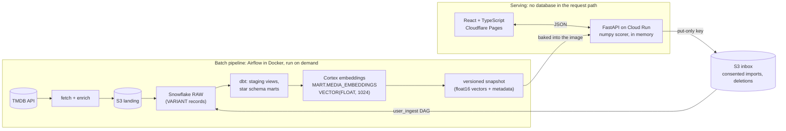

# PlotPoints

**Films you have not seen, ranked by how close they sit to the ones you rated highly.** Bring a
Letterboxd history, get a list for yourself or for a group, and see *why* each film was picked.

**Live: [watchplotpoints.com](https://watchplotpoints.com)** · a free, non-commercial passion project

PlotPoints is an end-to-end data and web project: a batch pipeline (TMDB → S3 → Snowflake → dbt →
Cortex embeddings) feeds a small in-memory recommender API on Cloud Run, which a React site on
Cloudflare Pages talks to. It is built and run by one person, so the interesting part is the set of
trade-offs, which are written down below and in [`docs/`](docs/).

## What it does

- **For you.** Ranks unwatched films from your taste. Every pick says which of your own liked films
  it resembles, and a "comfort-zone" pick shows something outside your usual genres.
- **Together.** Add up to six people and get one list by turns: each person contributes their own
  favourite that the others can also live with, and every film shows "top N% for you" per person.
- **Browse.** Filter by genre, theme (TMDB keyword), director, actor and decade, with *all of* /
  *any of* for several values of one kind.
- **Streaming.** Narrow to the services you have (US availability, via JustWatch data).
- **Franchises, film pages, and import.** Series shelves, per-film "for me" notes and similar films,
  and import from a Letterboxd export (parsed in the browser) or a public username.

## Architecture



Snowflake is the **batch** side. A visitor's request never reaches it: `just snapshot` exports the
embeddings and the metadata the app shows into a versioned, content-hashed snapshot (about 28.5k
titles), and the API image carries that snapshot, so every deploy serves exactly one known version of
the data. The API holds a person's films only for the length of a request.

## How the recommendations work

- **No averaged taste vector.** A profile is a set of films weighted by rating (`rating - 3`, so 4
  stars is liked and below 3 is disliked). Each candidate is scored against the few liked films it
  most resembles, because averaging a love of superhero films and of sports dramas gives a point
  near neither.
- **Similarity is standardized per film**, since some films sit close to everything and would
  otherwise appear in every list. Ratings matter twice: yours set how hard each film pulls, and a
  candidate's own TMDB rating is judged against *your* standard.
- **Franchises are damped** so one liked series does not fill the list, and the "because" notes use
  the undamped weights so the reason you see is the real one.
- **Group picks use turn-taking, not least-misery.** Least-misery (rank by the lowest member's
  score) is safe but drifts to bland middle ground; in real use its group lists were films the
  group did not actually want to watch. The rotation gives each person a turn to contribute a film from *their* top slice that
  everyone else also ranks in theirs (top 5%, relaxing to 10, 20 then 30% only when needed), one
  film per franchise. Checked against four real histories (only one of them large): it improved the
  worst-off member's median rank in every mismatched pair and kept the top-1% share roughly equal.
  Those are reasoned defaults checked on a handful of diaries, not tuned on a population, and the
  write-up says so ([`docs/roadmap.md`](docs/roadmap.md), "Evidence for group picks").
- **The scorer exists twice, on purpose.** SQL in `src/recommend.py` (batch, ad hoc) and numpy in
  `src/scoring.py` (served). They share their constants, and `tests/test_equivalence.py` holds them
  to the same ranking against live Snowflake.
- **Embeddings** are one `VECTOR(FLOAT, 1024)` per title from `voyage-multilingual-2` via
  `SNOWFLAKE.CORTEX.EMBED_TEXT_1024`, over a labelled document (genres, director, cast, keywords,
  tagline, overview; the title is left out on purpose). The dbt model is incremental on a document
  hash, so a rerun embeds only new or changed titles.

## Privacy, security and accessibility

- **No accounts.** Films live in the visitor's browser and travel with each request. A Letterboxd
  export is parsed in the browser; only (TMDB id, rating, rewatch) rows ever leave it.
- **Anonymous by design.** The API log holds the route template, status and time, plus a few
  count-only events with sizes as ranges ("15-49 films"). It never records titles, ids, ratings,
  usernames, tokens or addresses, so it cannot say who did anything.
- **Optional, deletable consent.** Imports kept to improve the catalog go to an S3 inbox through a
  **put-only** IAM key (it cannot read, list or delete). Deletion is by a one-time token kept only in
  the person's browser; only its SHA-256 is stored. The batch pipeline lands, deletes and purges.
- **Hardened edge.** A Content-Security-Policy and framing, permissions and HSTS headers on the
  site; per-address rate limits that forged forwarding headers cannot dodge; a request-size cap;
  public API docs off; dependencies audited. The review, with findings and what was fixed, is in
  [`docs/security.md`](docs/security.md).
- **Accessibility.** WCAG 2.2 AA colour tokens (contrast swept in each theme combination), visible
  focus, route-change focus management, keyboard navigation, light/dark/high-contrast themes, a
  dyslexia-friendly reading font (Atkinson Hyperlegible), text scaling, and reduced motion, all set
  before first paint.

## Engineering notes

- **Tests.** About 220 offline Python tests (scoring, matching, API, hardening, events, status
  checks, dashboard), 3 numpy-vs-SQL equivalence tests against live Snowflake (`-m snowflake`),
  52 frontend tests, dbt schema tests, and ruff.
- **Pipeline.** Airflow 3 in Docker (Astro): resumable catalog enrichment, idempotent loads per run
  id, a failure path verified with retries and backoff, and a `pipeline_monitor` DAG for freshness
  and cost.
- **Deploy.** The API image builds from a pinned dependency list and runs as a non-root user; the
  site and API are published by two scripts (`just deploy-web`, `just deploy-api`) that read their
  settings from `.env`, keep secrets in Secret Manager, and support a dry run.
- **Observability.** `just status` runs live checks (API health and data age, cache headers, CORS,
  the site, a deep link, certificate expiry); `just dashboard` builds a private page from the
  anonymous log; a Cloud Monitoring uptime check and a budget alert watch the rest
  ([`docs/dashboard.md`](docs/dashboard.md)).
- **Cost.** Hosting runs on free tiers (Cloud Run scales to zero, capped at two instances; Cloudflare
  Pages), plus a domain. A Snowflake resource monitor caps the warehouse. Measured on a 1,000-title
  trial and scaled per title, embedding a 50k-title catalog is about 0.45 AI credits.

## Tech stack

| Layer | Tools |
|---|---|
| Ingest and orchestration | Python 3.13, Airflow 3 (Astro, Docker), TMDB API, Letterboxd RSS and exports |
| Warehouse and modelling | Snowflake, dbt (`dbt-snowflake`), Cortex embeddings, Amazon S3 |
| Serving | FastAPI, numpy, Google Cloud Run, Secret Manager, Artifact Registry |
| Frontend | React, TypeScript, Vite, Tailwind CSS v4, Cloudflare Pages |
| Tooling | uv, just, pytest, ruff, vitest |

## Run it yourself

The live site needs nothing from you. To run your own copy you need your own TMDB, Snowflake and AWS
accounts to build the data; the API and frontend then run from a snapshot alone.

1. Install [uv](https://docs.astral.sh/uv/) and [just](https://github.com/casey/just), clone the
   repo, run `uv sync`, and run `npm install` in `web/`.
2. `cp .env.example .env` and fill it in. Provisioning each service is covered in
   [`docs/external_setup.md`](docs/external_setup.md). The Snowflake RSA key lives **outside** the
   repo.
3. `just smoke-test`, then `just test-all` to verify the Snowflake, S3 and TMDB wiring.
4. Build the data ([`docs/pipeline.md`](docs/pipeline.md)), then `just snapshot`.
5. `just api` and, in `web/`, `npm run dev`, then open <http://127.0.0.1:5173>
   ([`docs/frontend.md`](docs/frontend.md)).

| Command | Does |
|---|---|
| `just catalog-fetch` / `just catalog-enrich` | TMDB discovery, then a lean, resumable enrichment |
| `just load <diary\|catalog\|user_titles>` | NDJSON → S3 → `COPY` into `RAW.*` |
| `just dbt build` | Staging, marts and incremental embeddings |
| `just search "a lonely robot on a dying earth"` | Semantic search over the embeddings |
| `just recommend <user> [user2 …]` | Command-line recommendations from a diary (several users = least-misery) |
| `just snapshot` | Export `MART` into a versioned serving snapshot |
| `just api` / `just api-build` / `just api-run` | The API locally, as an image, and running that image |
| `just test` / `just test -m snowflake` / `cd web && npm test` | Offline tests; the numpy-vs-SQL check; frontend tests |
| `just airflow-start` / `-stop` / `-restart` | The local Airflow stack (UI on `localhost:8080`) |
| `just user-ingest` | Land consented imports and apply deletions |
| `just status` / `just dashboard` | Live health checks; a private usage page |
| `just deploy-api` / `just deploy-web` | Publish to Cloud Run and Cloudflare Pages (`-DryRun` first) |

## Project layout

```
src/              pipeline steps, scoring (numpy), snapshot format, status and dashboard tools
api/              the FastAPI service and its Dockerfile
web/              React + Vite + TypeScript + Tailwind frontend
dags/  include/   Airflow DAGs (catalog, diary, transform, user inbox, monitor); Airflow-only helpers
plotpoints_dbt/   dbt project: staging views and the star-schema marts
scripts/          deploy and secret-setup scripts, image requirements export
tests/            pytest suites
docs/             architecture, runbooks, security review
```

## Documentation

| Doc | What it holds |
|---|---|
| [`docs/roadmap.md`](docs/roadmap.md) | Architecture, decisions and their evidence, cost model, phase plan |
| [`docs/pipeline.md`](docs/pipeline.md) | Filling, refreshing and snapshotting the data |
| [`docs/frontend.md`](docs/frontend.md) | Running and testing the app |
| [`docs/deploy.md`](docs/deploy.md) | The launch runbook: Cloud Run, Cloudflare, domain, checklists |
| [`docs/dashboard.md`](docs/dashboard.md) | Watching the live site |
| [`docs/security.md`](docs/security.md) | The security review and its fixes |
| [`docs/external_setup.md`](docs/external_setup.md) | Provisioning TMDB, Snowflake and AWS |

## Credits and licence

This product uses the TMDB API but is not endorsed or certified by TMDB. Streaming availability is
from JustWatch via TMDB. PlotPoints is not affiliated with Letterboxd. Code is released under the
[MIT licence](LICENSE).
